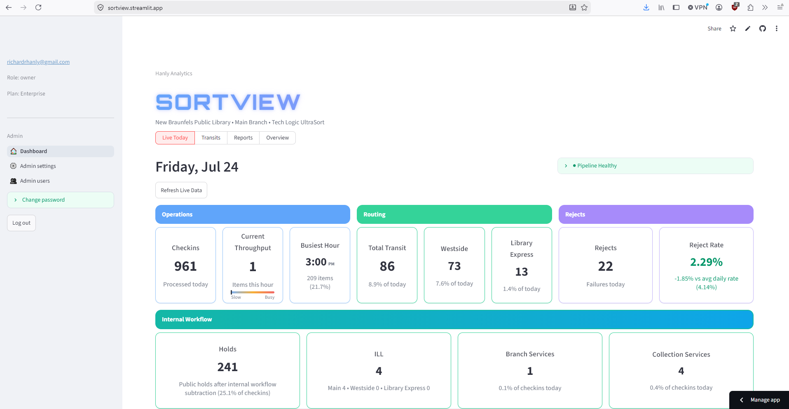

# SortView


SortView is a full-stack analytics and operations platform for Automated Materials Handlers (AMH) in libraries.

A Windows Collector on the AMH machine reads the sorter's Tech Logic logs and uploads activity to a FastAPI
backend, which stores it in Neon PostgreSQL. Library staff see live and historical sorter analytics in the
customer application, and SortView's platform administrators provision and manage libraries in a separate
React admin application.

The project was built around New Braunfels Public Library and Tech Logic UltraSort workflows, and is designed as a
multi-tenant service that other libraries can be onboarded to.

### What is in production today

| Surface | Status |
|---|---|
| Customer analytics UI | **Streamlit** dashboard (production) |
| Platform administration | **React admin** at https://admin.sortviewapp.com (production) |
| React customer app | Implemented and hosted for trial/testing only; **not yet the production customer UI** |

The React customer app is the intended replacement for the Streamlit dashboard. Moving customers to it, at
`https://app.sortviewapp.com`, is the next major milestone (see [Current Status](#current-status)).

---

## Dashboard Preview

The current customer analytics dashboard (Streamlit), showing a sorter's live day:

<p align="center">
  
</p>

---


## Demonstration of the AMH scanning and sorting a library material by its RFID tag


https://github.com/user-attachments/assets/46c64d68-90d8-4439-b8ac-3eb0a2b20a2c


---

## Key Features

**Data collection and ingestion**

* Ingestion of Tech Logic AMH check-in, reject and ACS logs
* Windows Collector with incremental processing, so records are not re-read or re-uploaded
* Authenticated ingestion: one-time enrollment codes and per-installation credentials
* Privacy-filtered upload contract (Contract v2) that sends typed events rather than raw log text
* Pipeline health reporting from the Collector to the backend

**Analytics**

* Live daily sorter activity: check-ins, hourly volume, routing and rejects
* Historical reports over a chosen date range, with previous-period comparison
* Transit and materials-flow reporting by configured destination
* Reject analysis by reason
* CSV export and print-friendly reports in the React customer app

**Platform**

* FastAPI API boundary for ingestion, the customer app and the admin app
* Neon PostgreSQL as the system of record, with Alembic-managed migrations
* Multi-tenant isolation between libraries
* React platform administration: library provisioning, installation management, one-time Collector enrollment
  codes, Collector settings, diagnostics and library lifecycle controls (suspend, reactivate, offboard)
* Automated backend and frontend testing in CI, with lint, type, static-analysis and dependency checks

---

## Architecture

```text
Tech Logic UltraSort / local AMH logs
              |
              v
Windows Collector (on the AMH machine)
- Reads new log records incrementally
- Parses and (Contract v2) filters them into typed events
- Tracks local state; retries failed uploads
              |
              v
FastAPI backend
- Authenticated ingestion
- Customer API (/api)
- Platform admin API (/api/admin)
- Pipeline status and diagnostics
              |
              v
Neon PostgreSQL
- System of record
- Multi-tenant data model
- Alembic schema tracking
              |
     +--------+--------------------------+
     |                                   |
     v                                   v
Customer application                React admin
- Streamlit: production today       - Platform administration
- React: implemented; production    - admin.sortviewapp.com
  cutover planned                   - Calls /api/admin
  (app.sortviewapp.com)
```

The Streamlit dashboard reads the database directly. The React customer app and the React admin app are static
single-page apps that talk only to the FastAPI backend, under `/api` and `/api/admin` respectively. Each React app
is served through its own CloudFront distribution, with `/api/*` forwarded to the backend.

---

## System Components

### Windows Collector

The SortView Collector runs on the Windows machine connected to the AMH. It:

* Reads Tech Logic check-in, reject and ACS logs
* Processes only newly added records and keeps local state between runs
* Uploads batches to the backend with retry and backoff
* Reports pipeline status after each run
* Enrolls with a one-time code issued from React admin, and stores its credential locally rather than in a config
  file

The Collector supports two upload contracts. **Contract v2** transforms records on the AMH machine and uploads only
privacy-safe, typed events (no barcodes, patron details, titles or raw log text). **Contract v1** is the original
row-level upload, still supported for compatibility.

The Collector lives in `collector/`, with install, update, repair, verify and uninstall scripts in
`collector/deploy/`. The older AMH agent code in `agent/` holds the canonical Tech Logic parsers the Collector
reuses, plus legacy agent code kept for compatibility and validation; see [agent/README.md](agent/README.md).
Collector details: [docs/collector-v2.md](docs/collector-v2.md).

### FastAPI Backend

The backend (`main.py`, `src/customer_api/`, `src/admin_api/`, `src/services/`) is the boundary between the outside
world and the database. It provides:

* **Ingestion** — `POST /upload` and `POST /upload-pipeline-status` (Contract v1), `POST /v2/upload` and
  `POST /v2/status` (Contract v2), and `POST /collector/enroll`
* **Customer API** (`/api`) — session sign-in, organizations and sorters, live and ranged reports, members,
  account and settings, scoped to the signed-in user's organizations and role
* **Admin API** (`/api/admin`) — platform-administrator-only routes for the React admin app
* Validation, rate limiting, tenant boundaries and pipeline-status recording

### Customer Application

**Streamlit (production today).** The customer dashboard in `src/app.py` and `src/pages/` is what library staff use
in production: live daily activity, transit and routing, reject analysis, reports and pipeline status.

**React (implemented, not yet production).** The React + TypeScript customer app in `frontend/` covers
organizations and sorters, Live Today, ranged operations and efficiency reports, members, account and password
reset, and settings. It is hosted for trial/testing and is the planned replacement for the Streamlit dashboard.
See [frontend/README.md](frontend/README.md).

### React Admin

The platform-admin app in `frontend/admin/` is for SortView platform administrators only; library staff do not use
it. It is hosted at https://admin.sortviewapp.com and calls the backend's `/api/admin` routes, where every request is
authorized server-side. It covers:

* Libraries list and library overview
* Provisioning a new library
* Operational identity assignment
* Collector settings and Internal Routing lists
* Installations and one-time enrollment codes
* Collector and pipeline diagnostics
* Library lifecycle: suspend, reactivate, offboard

The admin app is a separate build from the customer app, and CI checks that no admin code ends up in the customer
bundle.

### PostgreSQL Database

Neon PostgreSQL serves as the system-of-record database.

Schema changes are tracked through Alembic rather than being created dynamically inside application startup or
request handlers.

---

## Repository Structure

```text
amh-analytics-dashboard/
├── agent/          # Tech Logic parsers and legacy AMH agent code
├── collector/      # SortView Collector (Windows) and its deploy scripts
├── frontend/       # React customer app (src/) and React admin app (admin/)
├── src/            # Streamlit dashboard, customer/admin API routes, shared services
├── alembic/        # Database migrations
├── scripts/        # Operator scripts: health checks, release guards, maintenance
├── tests/          # Python test suite
├── docs/           # Deployment, runbooks and design notes
├── infra/          # CloudFront routing function
├── main.py         # FastAPI backend entrypoint
├── alembic.ini
├── requirements.txt
└── requirements-dev.txt
```

---

## Local Setup

### 1. Clone the repository

```bash
git clone <repository-url>
cd amh-analytics-dashboard
```

### 2. Python environment

Windows:

```powershell
python -m venv .venv
.venv\Scripts\activate
```

macOS or Linux:

```bash
python -m venv .venv
source .venv/bin/activate
```

Install dependencies (`requirements-dev.txt` adds the test and lint tools):

```bash
pip install -r requirements.txt
pip install -r requirements-dev.txt
```

### 3. Environment variables

`.env.example` lists the backend settings. Create a local environment file with your own values, for example:

```env
DATABASE_URL=
AGENT_API_KEY=
```

Do not commit production credentials or database connection strings.

### 4. Frontend

The React apps need Node 24 and npm (see `frontend/.nvmrc`):

```bash
cd frontend
npm ci
```

---

## Running the Application

### FastAPI backend

```bash
uvicorn main:app --reload
```

Production deployment uses its own start command and process manager; see [docs/deployment.md](docs/deployment.md).

### Customer dashboard (Streamlit)

```bash
streamlit run src/app.py
```

### React customer app

From `frontend/`:

```bash
npm run dev
```

The app uses an HttpOnly session cookie, so in development the Vite dev server proxies `/api` to a local backend.
Setup is in [frontend/README.md](frontend/README.md).

### React admin app

From `frontend/`:

```bash
npm run dev:admin
```

### Builds

From `frontend/`: `npm run build` (customer app) and `npm run build:admin` (admin app).

### Collector

The Collector is installed on an AMH machine with the scripts in `collector/deploy/` and an enrollment code from
React admin. For local work, a one-shot run is:

```bash
python -m collector.run --config <path-to-config.json>
```

See [docs/collector-v2.md](docs/collector-v2.md) and [agent/README.md](agent/README.md) before running anything
against real AMH files.

---

## Database Migrations

SortView uses Alembic to track and apply schema changes.

Check the current database revision:

```bash
alembic current
```

Create a migration:

```bash
alembic revision -m "describe the schema change"
```

Apply all pending migrations:

```bash
alembic upgrade head
```

The live database has already been baselined in Alembic.

Future schema changes should be implemented through migrations. A fresh database can be built entirely with
`alembic upgrade head` — the baseline migration reconstructs the full schema.

---

## Testing

**Backend (Python):**

```bash
python -m pytest
```

Run a specific test file:

```bash
python -m pytest tests/test_alerts.py
```

**Frontend (React)**, from `frontend/`:

```bash
npm run test:run
npm run lint
```

The tests run without the live AMH environment or the production database; frontend tests stub the API.

CI runs on pushes and pull requests to `main`:

* pytest
* ruff and mypy
* bandit and pip-audit
* test-freshness and release-readiness guards
* frontend tests, lint and both builds, plus a check that the customer build contains no admin code

Scheduled checks also watch backend uptime and whether each monitored library is still reporting in.

---

## Reliability and Security

* Authenticated Collector ingestion: one-time enrollment codes and per-installation credentials
* Contract v2 privacy boundary: raw patron and item data are filtered on the AMH machine before upload
* Tenant boundaries enforced by the API, with row-level security on operational event tables
* Customer access checked server-side by organization membership and role
* Admin routes authorized server-side for platform administrators only, on their own `/api/admin` boundary
* Origin checks on browser write requests; HttpOnly session cookies; rate limits on sign-in, password and upload
  endpoints
* Environment-based secret management
* Schema changes only through Alembic migrations, never in request handlers or at startup
* Collector local state that only advances after a successful upload, with retry and backoff
* Pipeline status and uptime monitoring

No API keys, database credentials, patron information, private logs, or production configuration files should be
committed to this repository.

---

## Operational Notes

* Alembic is never run from the AMH machine; AMH machines reach data only through the API.
* Database schema changes do not occur inside API request handlers or at startup.
* Collector changes reach an AMH machine only through a tested release and its install/update scripts.
* Deployment order and environment settings are in [docs/deployment.md](docs/deployment.md).

---

## Current Status

Current:

* AMH log ingestion, FastAPI backend and Neon PostgreSQL in production
* Customer analytics on the Streamlit dashboard (production)
* React customer app implemented and hosted for trial; not yet the production customer UI
* React admin in production at https://admin.sortviewapp.com, with the A2 platform-administration migration complete
* Super Admin Streamlit app retired
* SortView Collector with enrollment, guided setup and the Contract v2 privacy-filtered upload path
* Multi-tenant architecture
* Pipeline health monitoring and admin diagnostics
* Automated backend and frontend tests in CI

**Next major milestone — A4:** move the React customer app to production at https://app.sortviewapp.com and switch
customers to it, keeping New Braunfels Public Library live throughout.

---

## Roadmap

* **Customer cutover (A4):** React customer app in production at `app.sortviewapp.com`
* **Retire the Streamlit customer dashboard (A5)**
* **Self-service onboarding:** first-owner account at provisioning, a signed Collector download and a current
  install guide
* **Collector lifecycle:** replacement-machine workflow, key rotation and refreshing installed routing rules
* **Commercial flow:** plans and subscriptions
* **Multi-branch / multi-site** provisioning
* **Government readiness:** accessibility conformance, MFA/SSO, privacy and security documentation

---

## Skills Demonstrated

* Python and FastAPI REST API design
* React and TypeScript single-page apps
* PostgreSQL (Neon) data modelling and Alembic migrations
* Windows Collector/agent development: log parsing, local state, retry and installation scripts
* Multi-tenant SaaS architecture and server-side authorization
* Cloud hosting and deployment (CloudFront, S3, a managed backend host)
* Automated testing with pytest and Vitest
* CI with linting, type checking, static security analysis and dependency auditing
* Operational monitoring and pipeline-health reporting
* Streamlit dashboard development

---

## Disclaimer

SortView is an independent project designed around library automated-materials-handling workflows. It is not an
official product of, or endorsed by, Tech Logic, TLC, Neon, Streamlit, or any other vendor named here.

## License

SortView is proprietary software. All rights reserved.
See `LICENSE` for details.
